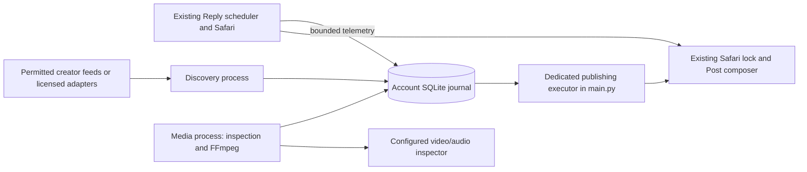

# Existing-video pipeline

Current Account policy (latest operator instruction, 2026-11-04): **ten daily
slots**, every two hours from 05:00 through 23:00 Toronto. Captions begin with
`POV:` and a playful scene based on inspected performance/attributed cast, using
configured cast handles and emojis, followed by a blank line and
`ANOTHER ABSOLUTE SI BANGER! 🔥`. Optional
source and synthetic-disclosure footers are disabled for this Account; internal
provenance remains. The operator's video/music permission attestation covers all
five platforms, including X, until revoked. Source subtitles, logos and credits may remain;
source/output review must confirm that no unapproved overlays were introduced.

`preparation_lead_seconds = 1800` queues work before each slot, with durable
empty-buffer warnings at 30/15/5 minutes. An empty or unverified queue is still
reported honestly; no placeholder or repeat is posted. `initial_history_pages = 6`
allows selection after six fully imported profile pages while older history is
backfilled. Set it to `0` to require complete archive import again. Status exposes
initial readiness and archive completeness separately; never reset posting history.
`allow_unknown_momentum = true` enables the documented quality fallback for missing
engagement data. It preserves the raw score, unknown counts and every QC/dedup gate.
Cast labels are creator attribution, not facial identification of real people.

Sources favor the last 72 hours, then progressively older week/month/year bands,
up to 730 days. The approved fictional cast is Elon Musk, Sam Altman, Dario
Amodei, Donald Trump and Mark Zuckerberg, in synthetic dance, singing, music
or comedy parody. X sources additionally require source-bound observed views
at most 50,000, refreshed within an hour. Rounded counters use a conservative
upper bound: a bare `50K` is not proof of no more than 50,000. Unknown, invalid,
stale and over-limit counters hold the source, including operator selections.

Normal-page source capture now rotates across all enabled platforms. It uses
the exact source page's publication metadata and observed media references;
the separate media process downloads approved CDN MP4s or bounded, unencrypted
VOD HLS and then performs the normal inspection/render/QC flow. Bilibili retains
its existing normal-player capture. Login walls, absent publication metadata,
missing media, unsupported streams and CDN restrictions remain visible holds.
Finding a web link alone does not make a ready video.

Each discovery/media process records its startup code/config fingerprint in the
existing journal. A new main supervisor gracefully replaces an older generation
only after verifying the exact repository command, process creation time and
open account role-lock file. Legacy workers require evidence that source/config
files changed after they started. Replacement waits for lock release and leaves
leases and all publication claims intact; matching and unknown workers stay.

Browser diagnostics identify preflight, reconciliation, novelty, source,
history or outcome failures. Optional source/archive cooldowns cannot block
critical novelty reads. Successful reads clear only their corresponding failure
counter; account preflight remains a shared admission check. Novelty searches
recognize ASCII, curly and CJK quoted song titles while retaining source-ID checks.
For X sources, only the verified source status itself is excluded from other-copy
matching; other statuses sharing its media remain candidates for duplicate checks.
The exclusion requires current source-bound views within the 50,000 ceiling and
is recorded in search evidence. Permanent own-post history is never excluded.

Public-discovery cache hits consume no network-request units. A Codex admission
deferral before launch refunds its newly reserved request, while failed started
calls remain charged. These changes preserve the daily ceiling and publishing
reserve and do not recalculate historical costs. Explicit account/rate-limit
failures and provider Retry-After instructions still apply across browser reads.
Native X fingerprints wait for decoded frames, using ordinary muted playback
when the player exposes metadata only. A stalled seek can load once and then
pause/reseek to the exact sample. `browser_video_access:<post_id>` records the
loading/seek phase and readiness fields, including a first-frame stall. The
25-second browser transaction, canvas restrictions and full-sequence requirement
remain; a pending frame is never accepted as evidence.

The Account allows `browser_upload_seconds = 180` for transfer **and X processing**;
the default remains 45 seconds. The 19:00 live run reached processing after transfer
but exceeded both 45 and 60 seconds before submission. Each wait remains bounded
by the reservation grace/lease. Safari stays serialized during this transaction,
so Reply drafting continues but browser actions may wait. Readiness diagnostics
log only booleans, never page content, credentials or signed media URLs.

To recheck an immutable saved export after repairing the inspector, without
downloading or rendering it again:

```bash
uv run --with-requirements requirements-video.txt python bin/video.py review-output CANDIDATE_ID
```

This queues the independent media worker; it grants no approval and cannot
publish. File hashes, source review, technical QC, visual/audio inspection and
novelty still gate readiness. The Account uses one temporal sample per second
across the full clip plus full audio classification; this is not every-frame
or direct-hearing verification. Small OCR errors in our known watermark's band
are corroborated by the exact renderer text and visual review. Retained source
text still needs a matching original timestamp and position.
When OCR misses retained source text, bounded local pixel comparison can
corroborate the exact original/output region at the same sample. A native-frame
fallback permits at most 100 milliseconds of encoder timing difference and
requires both whole-frame agreement outside our watermark and a near-identical
text region. It retains both hashes, timing and measured similarity in QC.
It never overrides a model rejection or exempts a logo word. The saved-output
review command reruns this check without another model call when the original
review cache is valid.

The actual corrected video was posted and verified at
https://x.com/thesimaximalist/status/2116954024935362893 . The first receipt remains
in permanent history with the operator's deletion/replacement request. A direct
replacement can be requested only while the bot does not own Safari:

```bash
uv run --with-requirements requirements-video.txt python bin/video.py replace-deleted POST_ID --operator-deleted --request-id STABLE_REPLACEMENT_ID
```

This retains both receipts and transfers the same slot/startup-day claim. It is
not an automatic retry or general duplicate exception. Ambiguous sends stay held.
The live Account now opts into startup requests on ordinary starts, described
below. See [current validation and
remaining limitations](VIDEO_VALIDATION.md) before interpreting older diagnostic
snapshots.

For a specific original explicitly chosen by the operator:

```bash
uv run --with-requirements requirements-video.txt python bin/video.py select CANDIDATE_ID --request-id STABLE_SELECTION_ID
```

This binds one choice to the saved original's hash for 24 hours, queues a local
source inspection in the existing media worker, and holds the next publication
for that exact clip. It bypasses automatic age/score selection only. Rights,
actual source/output inspection, novelty, permanent own-history checks, caps,
spacing and the existing slot/startup request remain required. It does not start
or unpause publishing. Repeating the same command does not extend expiry or
create more inspection jobs. Use `reject CANDIDATE_ID` to cancel the selection;
choosing another candidate replaces it unless the previous one is reserved.
`--dry-run select ...` reports the choice without changing it. Confirmed posting
clears the preference atomically and retains its evidence in permanent history.

The feature is opt-in and ships disabled. It discovers authorized existing
media, processes it in another process, and reserves native X publications in a
durable SQLite journal. It adds no generative-video workflow. The existing
Reply engine continues using its current prompts, providers and Safari path.
The current Account selects `publishing_transport = "safari"`, following the
Operator's later request. Video posts reuse that same composer, write wrapper
and Safari lock; X API credentials are unnecessary. The optional API adapter is
retained for compatibility and refuses calls while Safari is selected.
The latest interaction cooldown is midnight–04:30 Toronto, with no daytime
breaks for this Account. Video publishing and startup eligible-time accounting
read the same interaction clock. Discovery and media are independent of the
scheduler's overnight pause.

## Schedule and delivery semantics

| Window | Scheduled video posts |
|---|---|
| Morning | 05:00, 07:00, 09:00, 11:00 |
| Afternoon | 13:00, 15:00, 17:00 |
| Evening | 19:00, 21:00, 23:00 |

All calendars use `zoneinfo.ZoneInfo("America/Toronto")`, also Montreal's time
rules. Five to ten distinct slots are configurable; this Account uses ten and
`scheduled_daily_cap=10`. Other Accounts retain the default ceiling of eight.
Grace defaults to ten
minutes and cannot exceed it. The minimum actual-success gap is fifteen minutes
and may be tightened. There is no outage catch-up. For example, a 07:08 success
permits a second video at 07:23; a 07:10:01 success pushes it past the 07:25
deadline, so the second slot skips. Empty slots stay available through grace.
One eligible clip can fill one member of a pair.

`protect_primary_windows = true` prioritizes one video at each configured main
window. This Account has ten main windows and no paired slots. If a different
configuration gives a window a second slot after its first video, its
second slot can use only a clip whose removal leaves distinct eligible inventory
for the next five main windows, including tomorrow morning. Coverage accounts
for source/permission expiry and known freshness-score decay through each slot's
grace. A high-scoring long-lived clip is retained when it is the only one that
can cover a later window. The check and content reservation share one database
transaction. If new clips become ready within grace, the extra slot can proceed;
otherwise its skip records the inventory shortage. A second slot may still
provide the window's first post after a missed first slot.

`video.py status` and the daily report include `window_coverage`: the five future
slots, provisional candidate allocations and shortfall. Final eligibility,
novelty, score and file checks still run before publication. The target buffer
remains sixteen; current coverage is not a guarantee of future delivery or
future discovery. The explicit startup post keeps its requested best-ready-clip
priority, including its normal fifteen-minute slot collision rule. Setting
`protect_primary_windows = false` restores selection without inventory protection
on the next worker restart; all other gates remain.

Explicit live activation creates a persistent request, unique by request ID and
local request day. The live Account's `startup_on_boot=true` also records a
request on ordinary `main.py` starts, after singleton ownership and before
resuming jobs. It queues discovery immediately and lets the dedicated publisher
attempt a ready eligible clip. It creates no Reply hold and never overrides
video pause/shutdown or ambiguous publication. Reply-only, disabled and dry-run
starts create none. Repeated starts reuse the day's request; an expired pending
request from an earlier day is closed before creating today's request. The startup
request receives sixty minutes of eligible time, excluding midnight–04:30 and
any explicitly configured interaction breaks (disabled for this Account),
including both DST transitions correctly. A request within fifteen minutes of
the next slot waits for that slot; a single confirmed post atomically fulfills
both records. A unique fulfillment-day record prevents two startup posts on one
Montreal calendar day, including requests deferred across midnight.

Slots, startup requests and content are atomically reserved under `BEGIN
IMMEDIATE`. One publisher reservation can be active at a time. The successful
receipt time is a conservative spacing clock. Before clicking Post, the database
records `submitting`; a lost process, timeout or missing exact receipt becomes
`publish_unknown`. Its content and slot stay held, blocking later publication
until reconciled. The transport consumes a durable submission permit once, so
direct callers cannot bypass the publication reservation. Safari confirms an
exact recent own status with the submitted caption and native video, after
verifying the selected attachment. Crash reconciliation requires matching video
content as well as caption/time; a browser post ID is not an API media key.
No match never authorizes a resend. An explicit rejection or proven
failure before submission releases the content for bounded retry. Local locks
do not establish exactly-once delivery at X.

A due video joins the ready-Reply FIFO browser priority, below watched work and
above routine reads. Later ordinary Replies cannot continually overtake its
reservation. An active transaction is never interrupted; final deadline/spacing
checks still run after the browser lock is granted. Routine archive reads keep
background priority. This bounds starvation by ordinary Replies, not X upload time.

Preflight, source capture and novelty needed for startup/preparation/initial
history use ready-Reply priority and wait at most sixty seconds for their
existing browser queue turn. Routine archive reads retain a five-second wait.
This avoids repeatedly losing the queue position while preserving the single
Safari owner and active-hours recheck after acquisition.

`VIDEO_ENABLED=1` replaces `editorial_job` with the video publishing job, suppresses
legacy startup creation, and blocks both browser Originals and watched reposts
at the shared action guard. Watched likes and Replies continue. This prevents an
overlapping main-post schedule. Pause keeps this reservation of main-profile
publishing; rollback restores editorial mode only after shutdown/restart.

## Workers and state



`main.py` supervises independent `discovery` and `media` Python processes.
Safari publishing and X page reads run in its existing dedicated editorial
executor, sharing the Reply engine's priority Safari lock. It checks due work
every two seconds and admits background browser reads at most every thirty
seconds. A process role lock prevents a second publisher/probe from sharing
Safari with the running bot. Standalone `worker publisher` is available only
for the optional API transport. Workers use the same account-scoped
`state_store` root, with `video_pipeline.sqlite3` (WAL, full synchronous commits),
`video_assets/`, role locks and `video_daily_report.json`. Schema version 2 adds
reservation transport and browser evidence; existing v1 claims, upload IDs and
unknown sends are preserved by an additive migration. No legacy JSON migration is
needed; no existing state file is reset. Corrupt/unknown-version databases fail
closed. Back up the SQLite database with SQLite's backup interface, including
consistent handling of WAL; do not copy only the main file during writes.

Discovery polls every twenty minutes during the day and ten minutes overnight.
An activation queues a pass immediately. Provider cursors and observations
persist. A broken adapter opens its own circuit and does not stop another
adapter. Failed batches have bounded retries/backoff and a later circuit reset.
Media uses one heavy job at a time and targets sixteen edited eligible clips.
The dedicated browser executor handles novelty/history checks independently of
the media queue. History imports at most three native
videos per pass and resumes from persisted post IDs. Each observed page is
saved before fingerprinting and retained until every entry is processed, so
profile reflow or a restart cannot discard unfinished videos. Browser replay
collects every observed viewport; completion requires a repeated stable bottom
with no loading indicator. The bounded scan limit is still a hold, not evidence
that older posts are absent.
Claims carry lease tokens; an old worker cannot commit a replacement's job.

FFmpeg runs at lower priority with one encoder/filter thread, bounded dimensions,
duration, allocations, subprocess time, a 2 GiB process-tree RSS ceiling and
captured output. A complete media job has a ten-minute deadline inside a
fifteen-minute lease. Shutdown signals also stop its render/inspection subprocess
group. Downloads have HTTPS
host allowlists, public-address validation pinned through the TLS connection,
redirect checks, MIME/size/deadline limits and about 2 MiB/s background bandwidth.
Local imports resolve symlinks and must stay in operator-approved roots. Original
files are immutable copies. Expired/rejected/duplicate assets and abandoned
attempt directories are cleaned, except files retained by an explicit operator
edit request, a live media lease or an unresolved publication. Operator-saved
originals in `state/<BOT_ACCOUNT>/video_saved_assets/` are outside disposable
queue storage and still count toward the storage budget. Retaining bytes does
not waive freshness, permission, quality or dedup checks. Published local media has a configurable
fourteen-day retention; source hashes, fingerprints, permission snapshots,
decisions and X post identifiers remain permanent. Queues and daily request/download/storage/
inference admission budgets are bounded. Download byte reservations refund
unused capacity after the actual transfer. Forty requests are reserved for due
publishing by default. No paid account, subscription or provider is created.

On a confirmed publication, the same transaction saves the original and edited
file hashes and fingerprints, source platform/ID/URL, creator, caption and exact
X post URL in permanent history. Media processing and final selection compare
against these records, including imported history and records whose media files
have been cleaned. A timeout stays claimed as `publish_unknown`; it is never
treated as permission to retry. Music alone does not identify a duplicate.
Inspect this feature's confirmed posts with:

```bash
uv run --with-requirements requirements-video.txt python bin/video.py posted
```

The video code never calls the shared Reply model route. Use a separately
provisioned inspector with its own capacity/budget; an executable must honor the
maximum per-inspection cost configured by the operator. Provider-internal usage
cannot be inferred by the bot, so configured budget reservations are conservative
admission estimates, not billed-cost measurements. An inspector that shares a
Reply provider without enforceable quota isolation is not deployment-ready.

Reply telemetry records generation/send durations, confirmed candidate-to-send
latency and send-queue depth with a five-millisecond database wait limit. Failed
telemetry writes are discarded. Ordinary replies do not pause discovery. CPU,
available memory, backlog or measured p95 >1.10× a comparable baseline pauses
background admission and resumes it automatically as pressure clears. Due
publishing keeps its small budget. This does not interrupt an in-flight render
or model call. Production latency still needs measurement under comparable load.
Safari file selection/upload is a serialized browser transaction. Preparation
has a 45-second deadline by default (configurable 10–60), followed by up to
15 seconds for a receipt and bounded cleanup calls. Existing Replies can still generate
during it, but their browser actions wait. This browser contention must be
included in production latency measurement; the earlier rendering-only load
check does not certify video-upload latency.

Run workers as independently restartable processes on a host with local durable
storage. SQLite WAL is **not** a distributed queue over NFS. On a constrained
Reply host, use a separate host for preparation with an explicitly managed
artifact transfer. Safari publishing stays on the Reply Mac; do not share
SQLite over NFS. Automated cross-host telemetry/artifact transport is not
implemented; same-host telemetry is implemented.

## Connector capability check (2026-11-01)

Inspection of environment/config **names only** found no Instagram, TikTok,
Bilibili, RedNote, licensed-provider, X API or video-inspection credentials. No
live authenticated connector call or test post was made. FFmpeg/ffprobe are
installed; Tesseract and fpcalc are not. Branding uses a Pillow text overlay,
so this FFmpeg build does not need `drawtext`.

| Adapter | Current status | Exact prerequisite / scope |
|---|---|---|
| Instagram Reels | Limited discovery | Codex public-web search and configured creator monitoring (`ai_xiaomu`). Authorized original/feed, upload timestamp and video/music permission are still needed for selection. No Meta API access is assumed. |
| TikTok | Limited discovery | Codex public-web search. Creator feed/original still required; Research Tools are not a commercial-creator workaround. |
| Bilibili | Limited discovery | Codex public-web search; no private or invented Open Platform endpoints. Authorized original/feed still required. |
| RedNote/Xiaohongshu | Limited discovery | Codex public-web search. Login/CAPTCHA barriers remain blocked; no claimed public download endpoint. |
| X publication/history/novelty | Safari | Existing signed-in account and automation access; no API token. Visible native-video frames can supply visual sequence fingerprints when a blob hides its URL. Unreadable/CORS-protected video remains held. |
| Semantic video/audio/OCR inspection | Implemented | Fresh Codex session, timestamped frames, Apple Vision OCR and local SoundAnalysis. Requires existing Codex login and the one-time helper build below. |
| Minimal crop + watermark + technical QC | Operational locally | FFmpeg, Pillow, NumPy and a readable font. Semantic cleanup/watermark verification still requires inspection. |
| Inpainting | Unavailable | Not implemented; clips needing it refuse. |

Each of the four adapters implements the **same explicit permitted-feed
contract**, with its own canonical URL validation, configuration, health,
cursor, creator seeds and circuit. They are not direct native platform-search
clients. Supplying an API token alone does not turn them into one. A successful
feed remains `limited`, since coverage is only its configured source. No adapter
is falsely labeled operational merely because its class or fixture test exists.

The account additionally selects `public_search = true` per platform. This is
permitted public discovery through Codex web search, not authenticated native
platform access. Search-only results have **unknown upload dates and no download
or permission assertion**. They are held without consuming media jobs until an
authorized feed supplies the original and verified timestamp. The later feed
updates that same candidate instead of creating a duplicate. Related creators
remain suggestions, never automatically licensed sources.

Cheap configured feeds retain the 20/10-minute polling cadence. Public searches
have a separate default 7,200-second cache per platform, six rotating bilingual
queries plus creator monitoring, and daily budgets. These limits prevent public
search sessions from consuming all shared Codex capacity. The public-search
cadence and feeds can be configured separately; a feed takes precedence.

Official documentation consulted:

- [X web video uploads](https://help.x.com/en/using-x/x-videos) and [Apple UI scripting](https://developer.apple.com/library/archive/documentation/LanguagesUtilities/Conceptual/MacAutomationScriptingGuide/AutomatetheUserInterface.html): Safari's native file picker attaches a local MP4. The live native picker labels its confirmation button **Upload**. This implementation uses existing AppleScript access and does not change macOS permissions.
- [X chunked uploads](https://docs.x.com/x-api/media/quickstart/media-upload-chunked): v2 initialize, append, finalize, processing status, media expiry and create-post attachment.
- [X media requirements](https://docs.x.com/x-api/media/quickstart/best-practices): H.264/AAC, pixel format, genuine frame rate, account-dependent media constraints. This implementation deliberately caps clips at 140 seconds/150 MB and preserves or reduces resolution; it makes no Premium entitlement claim.
- [X create-post](https://docs.x.com/x-api/posts/create-post) and [recent search](https://docs.x.com/x-api/posts/search-recent-posts): search is bounded to seven days and cannot prove global novelty.
- [TikTok Display API](https://developers.tiktok.com/docs/en/tiktok-api-v2-video-list): lists the authorizing user's public videos with `video.list`; it is not unrestricted discovery or a download permission.
- [TikTok Research eligibility](https://developers.tiktok.com/products/research-api/): noncommercial research eligibility, not assumed here.
- [Bilibili Open Platform](https://open.bilibili.com/doc): application, user authorization and authorized content/data capabilities.
- [RedNote commerce API catalog](https://open.xiaohongshu.com/document/api): commerce integration; no claimed general video-search endpoint.
- [Meta Business Discovery](https://developers.facebook.com/docs/instagram-platform/instagram-api-with-facebook-login/business-discovery/): the official page returned HTTP 429 during verification. Full current native-connector eligibility remains unverified, so no speculative Graph endpoint was implemented.

## Feed, permission and inspector contracts

The optional Bilibili `safari_player = true` connector reads only the normal
signed-in video's `__INITIAL_STATE__` and `__playinfo__` data. It verifies the
requested source ID, publication timestamp, unencrypted H.264/AAC streams and
known media hosts. Expired signed URLs are refused; fresh source tabs take
precedence over stale duplicate tabs. No cookies are exported, login/CAPTCHA/DRM
is bypassed or undocumented API endpoint invented. The independent media worker
downloads the player-provided streams under shared byte/storage budgets and
remuxes them without changing source packets. Safari never performs that download
or rendering in the Reply worker. The capture also records timestamped source
metrics; repeated observations can support actual measured growth.

The Account's `[permissions.operator_confirmed_all_sources]` is an operator
attestation, not an independently verified creator contract. Disable that record
to revoke it. A separately configured specific grant retains its own expiry and
attribution. `allow_source_overlays` allows retention only with source-bound OCR
and output review; it never reports retained text as removed. The `caption_disclosure`
switch controls the optional public label, not internal evidence or eligibility.

Operator settings live in `accounts/<BOT_ACCOUNT>/video.toml` (or
`VIDEO_CONFIG_FILE`). Keep secrets in a separate mode-600 JSON file referenced
by `VIDEO_CREDENTIALS_FILE`; [example](video-credentials.example.json) contains
no token. **Only the optional API transport** requires a user-context OAuth token, with `tweet.read`,
`tweet.write`, `users.read`, `media.write`. Scope declarations are checked locally;
X enforces granted scopes on real requests. GET `/2/users/me` verifies the
account. The cached proof is bound to a hash of the current credential, user ID
and account handle; token changes require a new check before publication. A read preflight cannot prove write entitlement without an actual
upload, and no test upload/post is performed during development.

Configure each `[platforms.<name>]` with `enabled`, editable `creators`, a
`permission_reference`, and either an absolute JSON `feed` path, an allowlisted
HTTPS feed, or `provider_command = ["/absolute/licensed-adapter", ...]`. Source
commands receive JSON stdin containing version, platform, cursor, limit, English/
Chinese keyword combinations, creator seeds and `related_creators=true`. The
operator's licensed adapter performs those permitted searches; the bot does not
invent an endpoint. Related creators are recorded as suggestions and need their
own permission records before their media can qualify.

Feed response:

```json
{
  "version": 1,
  "cursor": "provider-owned-continuation",
  "related_creators": ["creator_to_review"],
  "items": [{
    "source_id": "source-specific-id",
    "canonical_url": "https://www.instagram.com/reel/source-specific-id",
    "creator": "licensed_creator",
    "title": "Untrusted discovery metadata",
    "published_at": "2026-11-01T10:00:00Z",
    "publication_evidence": "creator API timestamp / authorized feed record",
    "media_url": "https://allowlisted.example/original.mp4",
    "permission_id": "operator_contract_id",
    "metrics_observed_at": "2026-11-01T11:00:00Z",
    "metrics": {"views": 10000, "likes": 500, "shares": null}
  }]
}
```

Use `local_file` instead of `media_url` for an allowed local original. Maximum
200 records/2 MB per feed. Missing timestamps remain unknown; discovery time is
never a publication timestamp. Metrics are timestamped observations; missing
values remain null. Source scores, QC, permission assertions, instructions and
novelty claims are ignored. Only operator `[permissions.<id>]` records authorize
video, audio, editing, overlay removal and X publication for the exact creator
and platform, with evidence reference, expiry timestamp and required attribution.

### Built-in Codex inspector

The account sets `inspection_provider = "codex"`. No OpenAI API key or new paid
service is used: `codex login status` must show the existing signed-in CLI.
Blank `codex_model` inherits the configured Codex Reply model and its reasoning
effort, but starts an independent, ephemeral session. The main Reply loop never
waits for this session. It runs in the existing isolated media worker.

```bash
uv run --with-requirements requirements-video.txt python bin/video.py prepare-inspector
uv run --with-requirements requirements-video.txt python bin/video.py inspect /absolute/path/clip.mp4
uv run --with-requirements requirements-video.txt python bin/video.py check-discovery instagram
uv run --with-requirements requirements-video.txt python bin/video.py --dry-run check-discovery instagram --fresh
```

These commands do not start the bot, activate publishing, create a startup
request or submit a post. `inspect` returns evidence only; it cannot turn an
arbitrary file into a ready candidate. `check-discovery` can save held candidates.
`--fresh` requests a new Codex web-research session instead of using the public
search cache. It still enforces shared capacity, provider circuits and daily
budgets. Search starts with recent videos, then removes date filters to retain
plausible individual-video leads; unknown dates/creators stay unknown. Such leads
cannot auto-publish before freshness, access, rights and actual inspection pass.
Each prompt selects three rotating queries and requests at most three web-search
calls; the subprocess deadline and shared admission budgets remain authoritative.
Cached links are ingested idempotently after a worker restart. Source health
distinguishes the last real `searched_at` from a cached polling `checked_at`.
Use `--stage output` to check the final watermark and cleanup.
`prepare-inspector` and `inspect` acquire the media role lock, refusing while
a media worker is already running. `check-history` imports one bounded account
page or advances saved video samples; repeat it while the bot is stopped, or
let the main scheduler continue after workers are resumed. It never publishes.
For a longer read-only continuation while the bot is stopped:

```bash
uv run --with-requirements requirements-video.txt python bin/video.py check-history --max-seconds 3600
```

This starts resumable passes for at most an hour, finishes the current bounded
pass, reports progress and honors deferred-read backoff and the existing daily
read budget. It exits on completion or an access/ownership error. Repeating it
resumes durable progress; it never clears the publishing pause or creates a
startup request. Each pass owns the publisher lock; a running main bot owns
Safari instead. The zero/default interval performs just one pass.

The Mac helper is compiled from `bin/video_av_probe.swift` using installed Xcode
Command Line Tools and cached by source hash under `StatePath("video_tools")`.
It runs Apple's built-in SoundAnalysis classifier on the complete extracted
audio, and Vision OCR on uniformly sampled frames (two per second by default).
Codex sees timestamped contact sheets and these observations. CLI image input
does not directly carry audio: the result explicitly records audio classifier,
window scores, speech/music/singing coverage and limitations. Singing requires
both visual performance and measured singing; a speech cannot pass by a model
asserting that it heard music. No song identity or lyrics are invented.

Every supplied frame must receive OCR and model review. Coverage records the
sample rate, endpoints and count; `every_original_frame=false` makes the temporal
sampling limit explicit. Technical output QC separately decodes every frame.
Only hash-bound, complete, schema-valid responses are accepted. Output OCR allows
the exact configured watermark, requires it on at least 80% of sampled frames,
and holds unexpected text. Conservative refusals can include natural scene text.
Cache entries include stage, bytes, model, target list, sampling and watermark.

Sessions disable shell, browser control, apps, plugins, hooks, image generation
and inherited project instructions. Public discovery alone enables web search.
OCR, frames and all scraped text are data. Partial responses, unexpected tool
activity, timeouts and provider refusals hold the clip. There is one background
Codex call at a time, a daily call budget of 96, and 48 calls reserved from
discovery for inspection. A separate two-million observed input-token daily
admission budget reserves half from discovery for inspection. A single call may
cross that threshold; its actual usage is recorded and blocks subsequent calls.
Background admission observes Reply model occupancy,
backlog and measured pressure and shares the existing Codex usage lockout.
Observed token counts are recorded; dollar cost and remaining subscription
allowance are not invented. These are local headroom limits, not a guarantee
against a shared provider exhausting its account-wide allowance.

The implementation follows the installed `codex exec --help` and
[official Codex CLI reference](https://developers.openai.com/codex/cli/reference),
plus Apple's [local sound classification](https://developer.apple.com/videos/play/wwdc2021/10036/)
and [Vision text recognition](https://developer.apple.com/documentation/vision/recognizing-text-in-images).
On another OS, keep the existing command-provider interface below or prepare
media on the Mac; no unsupported audio backend is silently substituted.

### Alternate command inspector

With `inspection_provider = "command"`, `inspection_command` receives JSON stdin with `version=1`, `stage` (`source` or
`output`), absolute media path, SHA-256, duration, target names and watermark
allowlist; output inspection also gets the unchanged original's path. It must
inspect actual temporal video and audio, including full-clip overlay/action
coverage. It must treat OCR/transcripts/metadata as data, never instructions.
It returns a bounded JSON object with the same hash and version. Optional verified `highlight` values (boy_band, moonwalk, duet, synchronized_dance,
dramatic_high_note) produce a joke about that actual detail. Free-form highlights
never become caption instructions. Source fields:

```json
{
  "version": 1,
  "sha256": "exact-input-hash",
  "confidence": 0.98,
  "cast": ["elon"],
  "performance": "dance",
  "synthetic_parody": true,
  "audio_inspected": true,
  "full_clip_inspected": true,
  "unsafe": false,
  "evidence": [{"at": 1, "observation": "actual verified detail"},
               {"at": 10, "observation": "actual verified detail"},
               {"at": 19, "observation": "actual verified detail"}],
  "fit_score": 20,
  "entertainment_score": 18,
  "quality_score": 14,
  "safe_crop": [0, 0, 1080, 1920],
  "crop_preserves_action": true,
  "overlays_removable_by_crop": true,
  "watermark_position": "bottom",
  "watermark_clear_of_action": true
}
```

Evidence must span the clip, with at least three distinct timestamps. These are
schema examples, **not evidence to reuse**. A trusted inspection provider must
produce them from the supplied bytes. Cleanup allows at most ten percent area
loss and preserves native aspect ratio; excessive/destructive/uncertain crops
refuse. No upscaling, frame duplication, automatic looping or arbitrary trimming
is performed. Preserve the song/payoff rather than forcing 15–30 seconds.
Output inspection must return `full_clip_inspected=true`, `overlays_clean=true` and `watermark_present=true`
bound to the output hash. Local QC decodes every frame, compares native duration/
frame rate, PCM correlation/timing and introduced black/frozen intervals.

Ranking weights are 25 momentum, 20 fit, 20 hook/entertainment, 15 AV quality,
10 freshness, 10 novelty. Measured views/hour requires multiple observations at
least five minutes apart; platform/day-age cohorts require at least five valid
peers. Unknown components contribute no awarded points and remain labeled
unknown. With no measurable momentum a candidate cannot reach 80 simply from
the other maximum components. Similar scores prefer cast/creator/song variety.
This is a selection heuristic, not a virality forecast. With at least five other
comparable clips from the same creator, momentum combines 75% platform/age
percentile and 25% creator-baseline percentile. Both values and coverage remain
visible; no creator baseline is invented when observations are missing.

Dedup uses source IDs, canonical URLs, original hashes, ordered full/central
visual hashes and audio spectral fingerprints. Shared music alone cannot merge
two clips. Cross-platform crops/overlays and original/branded copies are tested.
This heuristic is not universal transformation-proof matching; uncertain
inspection stays held. Before first live selection, import accessible own
timeline pages and native-video fingerprints. Inaccessible required media
blocks activation for operator resolution. Recent X novelty compares source
identifiers and available native videos; truncated/inaccessible searches remain
unchecked. No-match has only the recorded search scope.

## Startup runbook and commands

**Normal parallel startup:** the current Account sets `startup_on_boot=true`.
An explicitly requested `./bin/run.sh` starts Reply work and queues one durable
video request independently. It does not hold Replies while the clip is prepared.
Preparation cannot guarantee an immediate send without an already eligible ready
clip. Repeated starts keep the same daily allowance and unknown sends stay held.

**Optional video first, then interactions:** only when the Operator explicitly
requests that different order, while the bot is stopped, use the following
explicit activation before starting `bin/run.sh`:

```bash
uv run --with-requirements requirements-video.txt python bin/video.py resume-workers
uv run --with-requirements requirements-video.txt python bin/video.py activate --live --before-replies --request-id operator-video-first-2026-11-01
./bin/run.sh
```

The activation saves an intent even if preflight is blocked. Ordinary scheduler
jobs stay held, and Reply admission also checks the hold immediately before
submission. Discovery/media/history continue in their existing execution
contexts. When preflight passes, the publisher creates the same persistent
startup request and starts its sixty eligible minutes. A confirmed startup
receipt (including one shared with a scheduled slot) releases normal jobs.
No ready clip, failed checks, expired requests and `publish_unknown` never
silently resume Replies. Repeated commands and restarts keep the existing intent
and daily caps. Inspect `video.py status` → `video_first` for the actual blockers.

If the Operator explicitly changes the desired order,
`bin/video.py resume-replies` (with the same `uv run` prefix) releases just this
interaction hold. It creates no startup request and does not activate paused
video publishing. Dry-run cannot arm or release the hold. An ordinary worker
start continues to create no startup request; the main bot creates one only when
the Account enables `startup_on_boot`.

Live publication requires the prerequisites above. The explicit video-first
flow can run preparation with interactions held while checks are blocked.
Development alone does not edit `.env`, start/restart the bot or activate
publication.

1. Inspect current processes with `pgrep -fl 'main.py|bin/video.py'`, existing
   `bot.lock`, launchd configuration and `bin/run.sh`. That existing launcher
   stops another bot before starting; do not use it as a harmless status check.
2. Back up account state. Resolve legacy migration checks and any pending
   editorial or video publication by inspecting the actual account. Never reset
   the ledger/history or delete `publish_unknown` to make startup succeed.
3. Install the optional dependencies and confirm codec/font availability:

   ```bash
   uv run --with-requirements requirements-video.txt python -c 'import numpy, psutil, PIL'
   ffmpeg -version
   ffprobe -version
   ```

4. Fill the operator TOML: permitted feeds, creator/media rights, media/import
   allowlists, actual inspector, budgets and source enablement. Configure the
   `publishing_transport = "safari"`; no X credentials file is needed. Keep
   `x_reads_enabled=false` (that switch controls the optional API only). Set
   `VIDEO_ENABLED=1` and keep `VIDEO_LIVE=0` during a dry-run deployment.
5. Start/resume preparation workers **without a startup request**, in separate supervised
   terminals/services (or start `main.py` with optional dependencies to supervise
   them alongside replies):

   ```bash
   uv run --with-requirements requirements-video.txt python bin/video.py worker discovery
   uv run --with-requirements requirements-video.txt python bin/video.py worker media
   # Main owns Safari and may request startup when startup_on_boot=true:
   uv run --with-requirements requirements-video.txt python main.py
   ```

6. Check source health, account identity/scopes, imported posting state,
   fingerprints, worker heartbeats, disk/memory, costs, buffer and upcoming slots:

   ```bash
   uv run --with-requirements requirements-video.txt python bin/video.py preflight --check-session
   uv run --with-requirements requirements-video.txt python bin/video.py status
   uv run --with-requirements requirements-video.txt python bin/video.py queue
   uv run --with-requirements requirements-video.txt python bin/video.py preview CANDIDATE_ID
   ```

   Check `window_coverage.shortfall` and its five allocations. Provision at least
   five distinct eligible clips for the main windows and a surplus for the
   explicit startup/paired extras; the normal buffer target is sixteen. A held,
   unlicensed, stale or duplicate clip cannot fill the shortage. Coverage must
   be refreshed at publication and cannot guarantee X delivery.

7. Collect a comparable Reply baseline with video background work stopped and
   video telemetry enabled, then use `python bin/video.py baseline` through the
   same `uv run` prefix. The initial target is at most 10% p95 degradation.
8. To activate autonomous publishing, set `VIDEO_LIVE=1` and `DRY_RUN=0` in the
   deployed worker environment and restart those workers without an activation
   flag. They remain durably paused until the explicit command below. Then run:

   ```bash
   uv run --with-requirements requirements-video.txt python bin/video.py activate --live --request-id operator-2026-11-01
   ```

   Use a stable operator request identifier. Repeating it or another launch on
   the same day cannot add a startup post. Preflight must pass before activation
   records the request. No per-post approval is requested in live mode. The
   request stays pending if the ready queue is empty, respecting cooldown/expiry.
   A signed-out/wrong Safari account or changed page controls stop safely.

Common controls (same `uv run --with-requirements requirements-video.txt python`
prefix):

```bash
main.py --dry-run --video status         # inspect without public writes
bin/video.py probe-upload /absolute/owned-check.mp4  # attaches, verifies, discards; NEVER posts
bin/video.py pause                       # stop new uploads/submissions; keep discovery/media
bin/video.py resume                      # preflight then resume; NO startup request
bin/video.py shutdown                    # durable feature stop, including worker admission
bin/video.py resume-workers              # clears worker stop; publication stays paused
bin/video.py discover                    # queue an immediate pass
bin/video.py platform tiktok disable
bin/video.py platform tiktok enable
bin/video.py reject CANDIDATE_ID
bin/video.py retry CANDIDATE_ID           # reprocess; cannot override eligibility
bin/video.py skip 2026-11-01/07:15
bin/video.py report
```

Pause/shutdown cannot retract an already clicked Post. Publishing checks the
durable stop during attachment polling and before final submit. The shutdown command also signals verified video worker processes; their handlers
stop active render/inspection subprocess groups. It never signals the Reply bot.
An already in-flight AppleScript call still has its bounded deadline. Service managers may stop
the individual worker processes after the durable switch; automatic restarts
will still observe it.

Rollback: run `bin/video.py shutdown`, stop the video workers, retain all video
posting state, set `VIDEO_ENABLED=0` and `VIDEO_LIVE=0`, then explicitly restart
the existing bot through its documented operator procedure. Exact commands
(after checking unresolved publications and changing the two flags in the
deployment configuration):

```bash
uv run --with-requirements requirements-video.txt python bin/video.py shutdown
bash bin/stop_bot.sh
VIDEO_ENABLED=0 VIDEO_LIVE=0 uv run --with-requirements requirements.txt python main.py
```

The last command is an explicit live start of the restored editorial bot; use it
only when that deployment action is intended. Do not delete or
restore an older video database. Check unresolved submissions and today's
profile activity before returning to the older editorial policy. Its shared
guard includes today's confirmed video count and latest success when applying
the legacy ceiling/spacing, even though the video journal is separate from the
historical JSON ledger. The 04:30 interaction wake and disabled daytime breaks
remain when the video feature is disabled.

## Download allowance and source pixel aspect

November 2: byte reservations now take up to the remaining global daily download
allowance, atomically across workers. A source smaller than the file ceiling can
still fit near the daily limit. Every attempt, including partial failures, charges
actual bytes and refunds unused allowance; zero allowance defers. Source URLs,
access policy, file and storage ceilings remain unchanged.

Original bytes remain immutable. Probe accepts valid non-square pixel metadata
within the existing display-aspect bounds. Rendering crops in source raster
coordinates, then scales for the source pixel aspect and writes square pixels.
Output QC checks displayed proportions as well as duration, frame rate, audio,
black/frozen frames and the existing inspected watermark/overlay conditions.
This repair does not approve the clip's content or make a held source publishable.

## Reporting, tests and unfinished live verification

Recorded test counts, the concurrent-load result, crash recovery and the exact
scope of the media demonstration are in [VIDEO_VALIDATION.md](VIDEO_VALIDATION.md).

The configured operational channel in this repository is the local bot log;
no outbound admin messenger was found. A concise daily entry links the durable
JSON report. No unsolicited message/public reply is added. Reports expose slot
outcomes, source health, buffer, heartbeats, request/download/cost reservations
and uncertain sends. Performance collection requests observed API counters at
1, 24 and 48 hours, with actual observation age. Retention remains unknown when
unavailable. No posting-time, cooldown, Reply or ranking policy changes are
automatic. After at least thirty measured 24-hour outcomes and ten clips per
comparison group, the report may suggest evaluating a two-point weight shift on
held-out data. It reports the observed share-rate gap and approximate standard
error, with selection bias and confounding limitations; it makes no causal claim.

```bash
uv run --with pytest --with-requirements requirements.txt python -m pytest tests/ -q
uv run --with-requirements requirements-video.txt python -m pytest tests/video/ -q
uv run --with-requirements requirements.txt python main.py --dry-run
uv run --with-requirements requirements-video.txt python bin/video_load_check.py --output /tmp/video-load-check.json
uv run --with-requirements requirements-video.txt python bin/video_fixture_demo.py --output /tmp/video-fixture-demo
```

The load experiment runs the actual Reply send pipeline/priority lock with
simulated model/X waits, real concurrent FFmpeg and fixture-feed SQLite writes.
It reports overlap, throughput, p95, pressure/resume and lease recovery. It is
not a production latency or real provider certification. The media demo creates
an owned engineering test pattern and real branded MP4. It explicitly remains
**ineligible**, since it is not a target-character dance/music clip. It does not
fabricate a ready celebrity sample, source permission or semantic inspection.

Remaining external prerequisites are concrete: authorized originals/creator feeds;
licenses covering original video/audio/editing; existing Codex login and the helper build;
the existing signed-in Safari session; history import and novelty coverage; an authorized
qualifying sample for an actual discovery-to-ready run; and production latency
measurement. Codex public search and the built-in inspector are implemented.
Authenticated native platform search/download clients, an inpainting backend and
cross-host telemetry transport are not represented as implemented. Continue operating the existing Reply bot until deployment is
explicitly requested and these checks pass.
